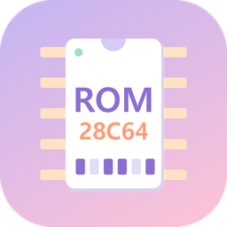
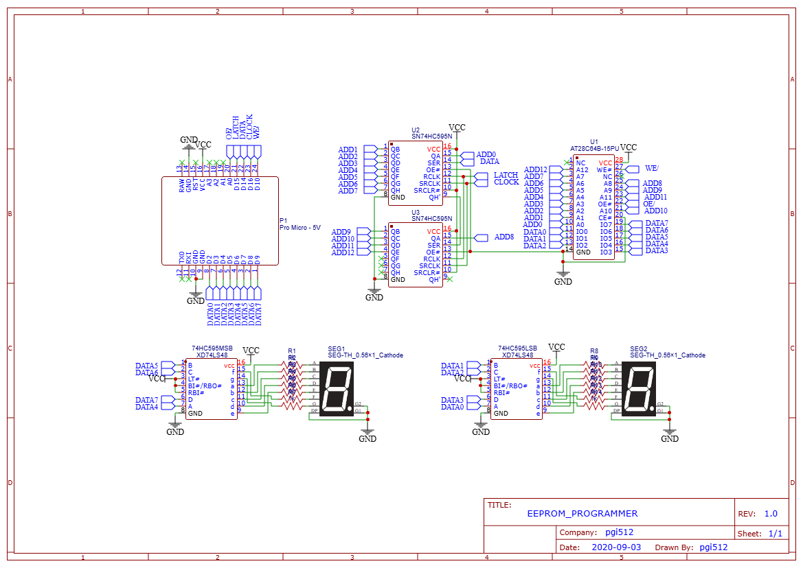

# ROM Writer

An **AT28C64 (8KB) EEPROM programmer** built on an Arduino Pro Micro, plus a **Windows GUI** to drive it.
Burn, read, compare, and byte-edit Logisim `.hex`, Intel HEX (`.ihx`), and `.bin` files on the EEPROM.
Built to burn the control ROMs and program ROM of a 4-bit computer.



## Layout

```
RomWriter/
├─ firmware/ROMWriter/   Arduino firmware (ROMWriter.ino v2.0)
├─ gui/                  PC GUI (Python / tkinter) + self-test + exe build script
├─ hardware/             Schematic (png), PCB Gerber files (zip), bill of materials (xlsx)
└─ release/              Built ROMWriter.exe (not tracked in Git → attached to GitHub Releases)
```

## Hardware

- Arduino Pro Micro (5V)
- AT28C64B-15PU EEPROM
- 74HC595N shift register ×2 (address lines)
- 7-segment display + 74LS48 ×2 (optional, status display)

| Arduino | Signal | | Arduino | Signal |
|---|---|---|---|---|
| D14 | SHIFT_DATA | | D10 | EEPROM_WE |
| D15 | SHIFT_LATCH | | A0 | EEPROM_OE |
| D16 | SHIFT_CLK | | D2 ~ D9 | EEPROM D0 ~ D7 |



| File | Contents |
|---|---|
| [`hardware/Schematic_AT28C64_Programmer.png`](hardware/Schematic_AT28C64_Programmer.png) | Schematic |
| [`hardware/Gerber_AT28C64_Programmer_PCB.zip`](hardware/Gerber_AT28C64_Programmer_PCB.zip) | PCB Gerber and drill files (2-layer), ready to upload to a PCB manufacturer |
| [`hardware/BOM_AT28C64_Programmer.xlsx`](hardware/BOM_AT28C64_Programmer.xlsx) | Bill of materials |

## Getting started

1. Upload `firmware/ROMWriter/ROMWriter.ino` to the Arduino Pro Micro.
2. Launch the GUI.
   - **exe**: `ROMWriter.exe` from Releases (no install needed)
   - **source**: `cd gui` → `pip install -r requirements.txt` → `python romwriter_gui.py` (or `run.bat`)
3. Pick the port, click **Connect**, then use the Read / Write / Edit / Tools tabs.

For detailed usage, shortcuts, firmware quirks, and how to build the exe, see **[gui/README.md](gui/README.md)**.

> The GUI's interface language is Korean.

## Testing

```
cd gui
python selftest.py
```

Runs write, verify, read, and edit scenarios against a fake device that mimics the firmware's serial behavior. (No real board required.)
The test hex files (`fib.hex`, `ctrl_rom1.hex`, etc.) are not in this repository; by default they are read from `../../GyuPuter-4bit/build`.
If they live elsewhere, set the `ROMWRITER_TEST_BUILD` environment variable to that folder.

## Status

- Reading (`HEXDUMP`) has been verified on a real board (COM16, Arduino Leonardo family).
- Writing (`LOAD`) has only been verified by the self-test, not yet on real hardware. Burn a small file first and check the verification result.
- Known limitations are listed in [gui/README.md](gui/README.md#known-limitations).

## License

[MIT](LICENSE)
